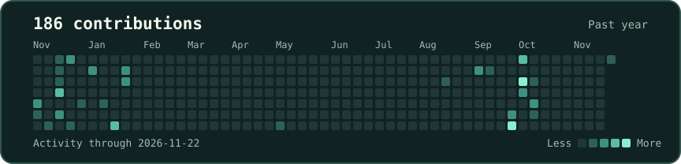

  <picture>
    <source media="(max-width: 600px)" srcset="./assets/profile/header-mobile.png">
    
  </picture>

  <a href="https://www.linkedin.com/in/ayush-patel-72a037316/">LinkedIn</a>
  &nbsp;·&nbsp;
  <a href="https://github.com/Ayush-patel9?tab=repositories">Repositories</a>

I’m a B.Tech student at **IIIT Bangalore**. I build full-stack applications and work on backend APIs. I’m interested in operating systems, computer architecture, and how databases execute queries.

## Selected work

<table>
  <tr>
    <td></td>
    <td><strong><a href="https://github.com/Ayush-patel9/SIH_2026">ManakAI</a></strong> Search and analysis tools for Indian standards and public procurement tenders. <code>FastAPI</code> · <code>React</code> · <code>TypeScript</code></td>
  </tr>
  <tr>
    <td></td>
    <td><strong><a href="https://github.com/Ayush-patel9/OS">ShopSync</a></strong> A concurrent e-commerce server with TCP clients, worker processes, and file locking. <code>C</code> · <code>TCP</code> · <code>POSIX</code></td>
  </tr>
  <tr>
    <td></td>
    <td><strong><a href="https://github.com/Ayush-patel9/docubuddy-answer-central">Fletchly</a></strong> A document assistant for asking natural-language questions about a team’s knowledge base. <code>React</code> · <code>TypeScript</code> · <code>Gemini</code></td>
  </tr>
  <tr>
    <td></td>
    <td><strong><a href="https://github.com/Ayush-patel9/Histogram">Histogram</a></strong> Database experiments using equi-depth histograms to estimate query selectivity. <code>Python</code> · <code>PostgreSQL</code></td>
  </tr>
</table>

## Toolkit

- **Languages** · Python, Java, TypeScript, JavaScript, C, C++, SQL
- **Frameworks** · FastAPI, Spring Boot, React
- **Data and tools** · PostgreSQL, Git

## On GitHub

## More work

- [Spring Boot e-commerce platform](https://github.com/Ayush-patel9/JAVA_TEAM_COLDBLOODED)
- [Umang 2025](https://github.com/Ayush-patel9/Umang2025), the campus festival website I contributed to
- [Memory Game](https://github.com/Ayush-patel9/Memory_Game), a Python game
